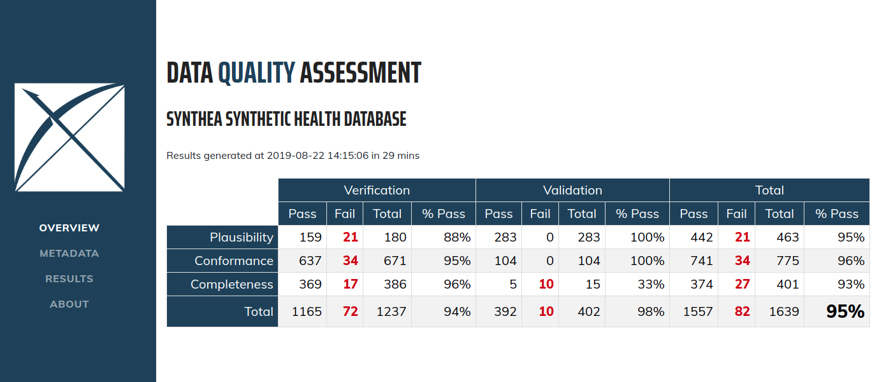

DataQualityDashboard
====================

<!-- badges: start -->
[](https://app.codecov.io/gh/OHDSI/DataQualityDashboard)
[](https://github.com/OHDSI/DataQualityDashboard/actions?query=workflow%3AR-CMD-check)
<!-- badges: end -->

DataQualityDashboard is part of [HADES](https://ohdsi.github.io/Hades/).

The goal of the Data Quality Dashboard (DQD) project is to design and develop an open-source tool to expose and evaluate observational data quality. 

System Requirements
===================
Requires R (version 3.2.2 or higher). Requires [DatabaseConnector](https://github.com/OHDSI/DatabaseConnector) (version 2.0.2 or higher).

A variety of database platforms are supported, as documented [here](https://ohdsi.github.io/Hades/supportedPlatforms.html).

Note that while data quality check threshold files are provided for OMOP CDM versions 5.2, 5.3, and 5.4, the package is currently only tested against versions 5.3 and 5.4.

To run the local KT runner (`runner/setup.R` / `runner/run_dqd.R`) end to end, you will also need:

* **Java (JDK or JRE)**, required by the JDBC driver `DatabaseConnector` uses to connect to the database.
* **A reachable PostgreSQL database with an OMOP CDM already loaded** (the runner is configured for PostgreSQL by default; other platforms from the supported-platforms list above will need the corresponding driver).
* **Environment variables for credentials**, rather than committing them to `runner/dqd_config.R` -- covered in Configure The Run below.
* **Network access to download the JDBC driver** the first time `runner/setup.R` runs (or set `DQD_DOWNLOAD_JDBC=FALSE` if you already have it in place).

Local KT Runner
===============

This checkout includes a local runner for executing DQD against a PostgreSQL OMOP CDM database and persisting failed-row details into custom result tables. The workflow is: Setup, once per machine, then Configure and Run each time you point it at a database. Each step is covered in its own section below.

Setup
=====

Run setup first on a new machine, new R library, or after package dependency changes:

```bash
cd DataQualityDashboard
Rscript runner/setup.R
```

`runner/setup.R` is installation-only. It installs missing R packages, installs the local `DataQualityDashboard` package, creates the configured JDBC driver directory, and downloads the JDBC driver unless `DQD_DOWNLOAD_JDBC=FALSE`.

If this step fails, treat it as an installation problem. Fix the R package, Java, compiler, or JDBC-driver issue, then rerun setup before running DQD.

Configure The Run
=================

The runner is configured through one file:

* `runner/dqd_config.R`

This file is gitignored and contains real credentials/host/schema names for your environment, so it is never committed. Before first use, copy the sanitized template and fill in your own values:

```bash
cp runner/dqd_config.example.R runner/dqd_config.R
```

Update `runner/dqd_config.R` for your database, schemas, checks, and output location. The important values are:

* `packagePath`: optional path used by `runner/setup.R` when installing the local package. Leave `NULL` to install this repository.
* `connection`: database type, user, password, server, port, and JDBC driver path.
* `schemas$cdm`: OMOP CDM schema to check.
* `schemas$results`: schema where DQD result tables and custom violation tables are written.
* `schemas$vocab`: vocabulary schema.
* `cdmSourceName` and `cdmVersion`: DQD metadata and threshold version.
* `execution$outputFolder` and `execution$outputFile`: where the generated `results.json` is written.
* `checkNames`, `tablesToExclude`, and `fieldsToExclude`: scope controls for which checks, tables, and fields run.
* `persistViolations`: when `TRUE`, failed violating rows are loaded into `dim_dqd_tests` and `fact_dqd_violations`.

For credentials, prefer environment variables over literal values in the file:

```bash
export DQD_DB_USER='your_username'
export DQD_DB_PASSWORD='your_password'
export DQD_DB_SERVER='your_host/your_database'
```

See `runner/dqd_config.example.R` for the full set of variables the config template reads.

Run DQD
=======

Run the configured DQD workflow only after setup has completed successfully:

```bash
Rscript runner/run_dqd.R
```

`runner/run_dqd.R` is runtime-only. It does not install or update R packages. If required packages are missing, it stops immediately and tells you to run `runner/setup.R`.

The runner will:

1. Load `runner/dqd_config.R`.
2. Check that required R packages are already installed.
3. Connect to the configured database.
4. Verify that `<cdm schema>.PERSON` is queryable.
5. Generate custom field/concept threshold CSVs when `fieldsToExclude` is populated.
6. Run `DataQualityDashboard::executeDqChecks()`.
7. Write `results.json` under the configured output folder. When `verboseOutput = TRUE`, also write a paired `<name>_rowLevelViolations.json` in the same folder. Row-level (patient-level) data is never written to `results.json` -- only to this paired file, and from there only into the database.
8. Persist failed violating rows to `dim_dqd_tests` and `fact_dqd_violations` when `persistViolations = TRUE`.

If this step fails after setup has succeeded, treat it as a runtime problem: configuration, database credentials, schema/table availability, DQD check execution, or result persistence.

Output Files
============

Each run writes:

* `results.json` -- the standard DQD results file. Flat `CheckResults` array, safe to view in the dashboard, export to CSV, or hand off elsewhere. Never contains row-level data.
* `<name>_rowLevelViolations.json` (only when `verboseOutput = TRUE`) -- row-level detail for failed checks, same folder, named after `results.json`. Consumed only by `writeDqdJsonToCustomTables()` to populate the database; not viewed directly.

For the full field-by-field schema of both files and the reasoning behind the split, see [`RESULTS_SCHEMA.md`](RESULTS_SCHEMA.md).

View The Dashboard
===================

To view a generated `results.json` in the Shiny dashboard:

```bash
Rscript runner/smoke_test_viewer.R
```

This reads `outputFolder`/`outputFile` from `runner/dqd_config.R` and launches `DataQualityDashboard::viewDqDashboard()` against it. Confirm the results table renders, a row expands to show check detail, search/filter works, and CSV export works.

You can also call `DataQualityDashboard::viewDqDashboard("path/to/results.json")` directly for any results file.

Entry Points
============

Scripts (run these):

* `runner/setup.R`: installation and JDBC-driver setup.
* `runner/run_dqd.R`: config-driven DQD execution and result persistence.
* `runner/smoke_test_viewer.R`: opens a generated `results.json` in the Shiny dashboard for a manual visual check.

Configuration files (edit these, don't run them):

* `runner/dqd_config.R`: database, schema, check, output, and persistence configuration. Gitignored; never committed.
* `runner/dqd_config.example.R`: sanitized template for `runner/dqd_config.R`; copy and fill in your own values.

There is no `initial.R` entrypoint. The old one-off scripts were consolidated into `runner/run_dqd.R`.

The old `analysis/` and `to_run/` script folders were consolidated into `runner/` to keep one clear execution path.
Top-level exploratory notebooks and review artifacts, if needed for KT context, live in `../reference_artifacts/`; they are not required to run DQD.

For Developers
==============

Developer-focused notes for the local runner, changed files, and custom result-table architecture are in [`FOR_DEVELOPERS.md`](FOR_DEVELOPERS.md).

Introduction
============

This package will run a series of data quality checks against an OMOP CDM instance (currently supports v5.4, v5.3 and v5.2). It systematically runs the checks, evaluates the checks against some pre-specified threshold, and then communicates what was done in a transparent and easily understandable way. 

Overview
========

The quality checks were organized according to the Kahn Framework<sup id="kahn">[1](#f1)</sup> which uses a system of categories and contexts that represent strategies for assessing data quality. For an introduction to the kahn framework please click [here](https://pmc.ncbi.nlm.nih.gov/articles/PMC5051581/). 

Using this framework, the Data Quality Dashboard takes a systematic-based approach to running data quality checks. Instead of writing thousands of individual checks, we use “data quality check types”. These “check types” are more general, parameterized data quality checks into which OMOP tables, fields, and concepts can be substituted to represent a singular data quality idea. For example, one check type might be written as 

*The number and percent of records with a value in the **cdmFieldName** field of the **cdmTableName** table less than **plausibleValueLow**.*

This would be considered an atemporal plausibility verification check because we are looking for implausibly low values in some field based on internal knowledge. We can use this check type to substitute in values for **cdmFieldName**, **cdmTableName**, and **plausibleValueLow** to create a unique data quality check. If we apply it to PERSON.YEAR_OF_BIRTH here is how that might look: 

*The number and percent of records with a value in the **year_of_birth** field of the **PERSON** table less than **1850**.* 

And, since it is parameterized, we can similarly apply it to DRUG_EXPOSURE.days_supply: 

*The number and percent of records with a value in the **days_supply** field of the **DRUG_EXPOSURE** table less than **0**.* 

Version 1 of the tool includes 24 different check types organized into Kahn contexts and categories. Additionally, each data quality check type is considered either a table check, field check, or concept-level check. Table-level checks are those evaluating the table at a high-level without reference to individual fields, or those that span multiple event tables. These include checks making sure required tables are present or that at least some of the people in the PERSON table have records in the event tables. Field-level checks are those related to specific fields in a table. The majority of the check types in version 1 are field-level checks. These include checks evaluating primary key relationship and those investigating if the concepts in a field conform to the specified domain. Concept-level checks are related to individual concepts. These include checks looking for gender-specific concepts in persons of the wrong gender and plausible values for measurement-unit pairs. For a detailed description and definition of each check type please click [here](https://ohdsi.github.io/DataQualityDashboard/articles/CheckTypeDescriptions). 

After systematically applying the 24 check types to an OMOP CDM version approximately 4,000 individual data quality checks are resolved, run against the database, and evaluated based on a pre-specified threshold. The R package then creates a json object that is read into an RShiny application to view the results.





Features
========
- Utilizes configurable data check thresholds
- Analyzes data in the OMOP Common Data Model format for all data checks
- Produces a set of data check results with supplemental investigation assets.

Data Requirements
=================

Prior to execution the DataQualityDashboard package requires that the CDM_SOURCE table is properly populated.  The following table is a guide to the expected contents of the CDM_SOURCE table.

cdmFieldName | userGuidance | etlConventions
-- | -- | --
cdm_source_name | The name of the CDM instance. | Descriptive name for the source   data.
cdm_source_abbreviation | The abbreviation of the CDM   instance. | The abbreviation should   consistent for different release from the same source.
cdm_holder | The holder of the CDM instance. | The institution that controls   access to the data.  If possible   include contact information for who to contact to request access to the data.
source_description | The description of the CDM   instance. | Add notes, caveats, special   characteristics about the source data that would not be assumed from the   general descriptive name.  This   description intended to help analysts determine if the data is suitable for   the problem they are studying.
source_documentation_reference | Reference to where one can find   documentation about the source data. | Can include URLs, file name,   source data experts contact information (if they agree to it)
cdm_etl_reference | Reference to where one can find   documentation about the source to ETL into OMOP CDM. | Assuming there is a document or   files (such as Rabbit in the Hat) describing the ETL.  May be the location of the ETL source and   documentation repository.
source_release_date | The release date of the source   data. | When the source data was made   available for ETL'ing.  For sites doing   incremental updates, the date the last increment made available.  This implies that for sites doing incremental   updates the CDM Source table should be updated to reflect that changes were   made to the CDM.
cdm_release_date | The release date of the CDM   instance. | When the source data was made   available for general use.  For sites   doing incremental updates, this implies that the CDM Source table should be   updated to reflect that changes were made to the CDM.
cdm_version | Identifies the CDM version | Enter the numeric portion of the   version, e.g. 5.4
cdm_version_concept_id | The Concept Id representing the   version of the CDM. | SELECT concept_id WHERE domain =   Metadata and vocabulary_id = CDM and concept_code like %[numeric portion of   the version]%
vocabulary_version | The vocabulary version used in   the ETL | Obtained by SELECT   vocabulary_version FROM vocabulary WHERE vocabulary_id = 'None'

Technology
==========
DataQualityDashboard is an R package 

Upstream Package Installation
=============================

The section below is the original OHDSI package installation guidance. For this checkout's local KT workflow, use `runner/setup.R` followed by `runner/run_dqd.R` as described above.

1. See the instructions [here](https://ohdsi.github.io/Hades/rSetup.html) for configuring your R environment, including RTools and Java.

2. In R, use the following commands to download and install DataQualityDashboard:

  ```r
  install.packages("remotes")
  remotes::install_github("OHDSI/DataQualityDashboard")
  ```

User Documentation
==================
Documentation can be found on the [package website](https://ohdsi.github.io/DataQualityDashboard/index.html).

PDF versions of the documentation are also available:

* Vignette: [Add a New Data Quality Check](https://github.com/OHDSI/DataQualityDashboard/raw/main/inst/doc/AddNewCheck.pdf)
* Vignette: [Check Status Descriptions](https://github.com/OHDSI/DataQualityDashboard/raw/main/inst/doc/CheckStatusDefinitions.pdf)
* Vignette: [Running the DQD on a Cohort](https://github.com/OHDSI/DataQualityDashboard/raw/main/inst/doc/DqdForCohorts.pdf)
* Vignette: [Failure Thresholds and How to Change Them](https://github.com/OHDSI/DataQualityDashboard/raw/main/inst/doc/Thresholds.pdf)
* Vignette: [SqlOnly Mode](https://github.com/OHDSI/DataQualityDashboard/raw/main/inst/doc/SqlOnly.pdf)
* Package manual: [DataQualityDashboard manual](https://github.com/OHDSI/DataQualityDashboard/raw/main/inst/doc/DataQualityDashboard.pdf) 

Support
=======

* Developer questions/comments/feedback: <a href="http://forums.ohdsi.org/c/developers">OHDSI Forum</a>
* We use the <a href="https://github.com/OHDSI/DataQualityDashboard/issues">GitHub issue tracker</a> for all bugs/issues/enhancements 
 
License
=======
DataQualityDashboard is licensed under Apache License 2.0

Development
===========
DataQualityDashboard is being developed in R Studio.

### Development status

DataQualityDashboard latest release (representing code in the `main` branch) is ready for use. 

# Acknowledgements
- This project is supported in part through the National Science Foundation grant IIS 1251151.

<b id="f1">1</b> Kahn, M.G., et al., A Harmonized Data Quality Assessment Terminology and Framework for the Secondary Use of Electronic Health Record Data. EGEMS (Wash DC), 2016. 4(1): p. 1244. [↩](#kahn)
